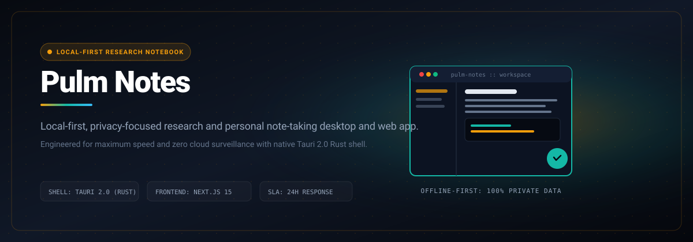

# Pulm Notes

> Local-first, privacy-focused research and personal note-taking desktop and web app.

```bash
git clone https://github.com/Luxion-Labs/PulmNotes.git && cd PulmNotes && npm install && npm run dev
```



[](https://pulm.luxionlabs.com) [](LICENSE) [](CONTRIBUTING.md)

## Overview
Local-first, privacy-focused research and personal note-taking desktop and web app. Built by Luxion Labs as part of our high-velocity open-source engineering ecosystem.

## Features
- Local-first architecture with instant offline availability.
- Markdown-powered canvas and organized tag indexing.
- Cross-platform web and native desktop support.
- Zero cloud dependencies or surveillance telemetry.

## Architecture and Stack
React 19, TypeScript, Vite, Tailwind CSS, Lucide icons, and Tauri desktop packaging.

## Quickstart
```bash
git clone https://github.com/Luxion-Labs/PulmNotes.git && cd PulmNotes && npm install && npm run dev
```

## Maintainer Response SLA
Luxion Labs enforces a strict 24-hour response SLA on all community issues, feature proposals, and pull requests. See [CONTRIBUTING.md](CONTRIBUTING.md) for full development guidelines.

## License
Distributed under the MIT License. See [LICENSE](LICENSE) for more details.
